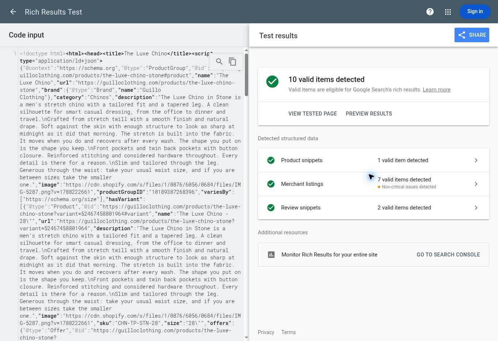

# Product structured data audit, 8 November 2026

## Source and scope

The two Google Search Console emails dated 6 November were read directly. They call all five findings **non-critical** and do not include affected page URLs. The findings below describe the current storefront; they do not establish which exact URLs or nodes Google sampled on 6 November.

The default repository branch is `claude/guillo-shopify-theme-lppws6`, but the live theme is **Guillo — Redesign Preview**, ID `186705805612`. The matching source is `design/guillo-redesign`, at `991b63000ec3a5f1e723ca455dac28ad70c9cf94`. The live `sections/guillo-editorial-product.liquid` and this branch's file have the same MD5, `97d5adaabd02da5b5347a9d3fe68d44c`. This PR targets that branch and changes no Shopify files directly. Merging into a connected theme branch can update Shopify, so obtain Will's approval before merging or publishing.

All 43 public products returned by `/products.json?limit=250` were checked. Their current markup contains 38 `ProductGroup` nodes and five `Product` nodes. All 43 parent descriptions are populated. The child `Product` nodes for size variants omit descriptions. Shipping and return information is absent from their offers. Existing aggregate ratings appear on 26 pages.

## The five warnings

| Field | Current evidence | Proposed treatment |
| --- | --- | --- |
| `description` | Present on all parent products/groups; omitted on child size variants. This is an observable omission, rather than missing catalogue copy. | Render the actual Shopify description on the parent and every child Product. No invented fallback copy. |
| `shippingDetails` | Absent from offers. Australian rates and delivery estimates are published. | Add the published Australian standard service to available physical variants offered in AUD. Omit normal shipping estimates for preorders and unavailable variants. Leave unverified international services out. |
| `hasMerchantReturnPolicy` | Absent from offers. Refund policy states 44 days from delivery; the banner and delivery panel advertise free returns in AU/NZ. | Add a finite 44-day policy with free returns applicable only to AU/NZ, linked to the actual policy. Do not infer international return costs or a return method. |
| `aggregateRating` | Some stored totals describe collections rather than the exact item. | Compute only from published/featured, non-store reviews whose product ID matches the page. Omit when no valid ratings exist. |
| `review` | No individual review markup. Reviews load from Klaviyo's public storefront feed. | Use real author, text, score and date from that same feed, for this exact product only. No placeholder reviews. |

All five are optional/recommended fields in this context, rather than current eligibility errors. Google product snippets require a name and at least one of `offers`, `review` or `aggregateRating`; an offer can satisfy that requirement on its own. An unrated product should retain an honest optional review warning.

## Verified policies

Sources: [shipping page](https://guilloclothing.com/pages/shipping), [refund policy](https://guilloclothing.com/policies/refund-policy), and the live product delivery panel / `guillo-shipping-panel.liquid`.

- Australian standard: AUD 9.95, free on orders **over** AUD 100. The offer evaluates the published threshold for one unit at its current offered price; it does not depend on the visitor's cart.
- Published Australian delivery estimate: 2–4 days. This is represented as the service's transit estimate. No separate handling-time guarantee is added.
- Express is advertised as AUD 14.95, free over AUD 200. This PR uses only standard service, so it does not guess a separate express delivery estimate.
- Returns: 44 days from delivery for refund or exchange. Free returns are explicitly advertised for Australia and New Zealand; no free-return claim is made for other countries.
- Preorder timing follows the product page. Preorders are marked `PreOrder`, without the normal shipping estimate. Interest-only sections emit no purchase schema.

The Shopify REST shipping-zone read returned zones but empty legacy rate arrays. The GraphQL delivery-profile read was denied by the connection's scopes. No permissions were changed and no alternate administrative route was attempted. Rates above are verified against published customer information, not independently against the current checkout configuration. Merchant Center and Search Console settings, which can override page markup, were not changed or verified.

## Review accuracy

The live Luxe Stone page and its Shopify review metafields report **4.79 / 39 reviews**. The current public Klaviyo response identifies that group as **Collection: Chinos**, and its 39 published reviews span eight product IDs, including Signore. Only **one** belongs to Luxe Stone (`10189387268396`), rated **5/5**. Portofino Black (`10229273428268`) has no review metafields and its public feed contains **zero reviews**.

The replacement avoids collection metafields. After the existing widget loads its published feed, it filters by exact product ID, removes duplicate review IDs, validates scores and adds the exact product's rating/reviews to the same JSON-LD script. Up to ten written reviews are included; the aggregate uses all matching valid ratings. A small visible **“This item”** summary makes that exact score/count available to customers beside the existing family summary. Individual reviews remain accessible in the existing list and “Read more” control.

Product, variant, price, description, shipping and return data are server rendered. Reviews require the existing widget's JavaScript and a successful feed load. If JavaScript or the feed fails, no rating is fabricated; optional warnings can remain. Server-side review synchronization would be a separate integration, not a hardcoded snapshot of today's reviews.

## Validation

- `npm ci` followed by `npm test`: ten checks cover Shopify Liquid parsing, JSON output, variants, exact price/threshold boundaries, foreign currencies, preorder/interest/unavailable behavior, review pagination/deduplication/product filtering, network failures and script-safe escaping.
- Local rendering with the fetched catalogue data: **43 products / 209 variants**, including **seven preorder pages**. Prices, 195 non-empty SKUs, image URLs, descriptions, return countries and preorder shipping omissions were checked. The real Luxe Stone feed produced one 5/5 rating and its actual review; Portofino Black produced no rating or review.
- Shopify Theme Check 4.0.0: **102 findings on the base and 102 on the proposed theme; no new findings**. Existing findings, including an unrelated image-dimension error, were not expanded into this change.
- JavaScript syntax and `git diff --check` pass.
- [Google Rich Results Test, code mode](https://search.google.com/test/rich-results/result?id=pmwVYYXnl4-I1Cf6OQtVXw): the rendered Luxe Stone sample **after its real review feed loads** yields **seven valid merchant listings, one valid product snippet and two valid review snippets**. The submitted JSON was checked against the locally rendered JSON: length 15,436; FNV-1a `71980591`.

The Google test retains optional `returnMethod` warnings, optional `handlingTime` warnings on in-stock variants, and omitted shipping information on out-of-stock variants. The first two are not filled with assumptions. The test is a code sample, not validation of a deployed Shopify change or a Google indexing/ranking guarantee.

## Approval and release

No merge, publication, live-theme asset change, product/metafield update or Search Console validation request was made. After approval, review the exact diff, deploy through the existing theme process, test rendered Shopify pages in Google again (including an unrated product and preorder), and only then start Search Console validation. Search Console warning counts will not change just because this PR exists.

References: [Google merchant listings](https://developers.google.com/search/docs/appearance/structured-data/merchant-listing), [product snippets](https://developers.google.com/search/docs/appearance/structured-data/product-snippet), [product variants](https://developers.google.com/search/docs/appearance/structured-data/product-variants), [Shopify structured_data filter](https://shopify.dev/docs/api/liquid/filters/structured_data).
