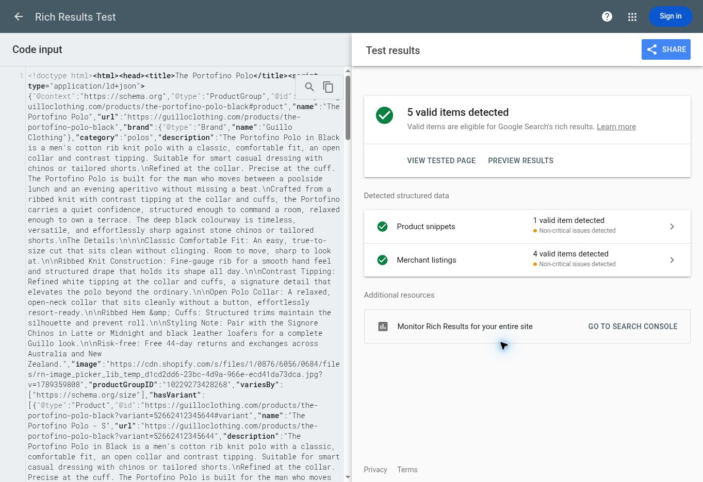

# Product structured data audit, 8 November 2026

## Source and scope

The two Google Search Console emails dated 6 November were read directly. They call all five findings **non-critical** and do not include affected page URLs. The findings below describe the current storefront; they do not establish which exact URLs or nodes Google sampled on 6 November.

The default repository branch is `claude/guillo-shopify-theme-lppws6`, but the live theme is **Guillo — Redesign Preview**, ID `186705805612`. The matching source is `design/guillo-redesign`, at `991b63000ec3a5f1e723ca455dac28ad70c9cf94`. The live `sections/guillo-editorial-product.liquid` and this branch's file have the same MD5, `97d5adaabd02da5b5347a9d3fe68d44c`. This PR targets that branch and changes no Shopify files directly. Merging into a connected theme branch can update Shopify, so obtain Will's approval before merging or publishing.

All 43 public products returned by `/products.json?limit=250` were checked. Their current markup contains 38 `ProductGroup` nodes and five `Product` nodes. All 43 parent descriptions are populated. The child `Product` nodes for size variants omit descriptions. Shipping and return information is absent from their offers. Existing aggregate ratings appear on 26 pages.

## The five warnings

| Field | Current evidence | Proposed treatment |
| --- | --- | --- |
| `description` | Present on all parent products/groups; omitted on child size variants. This is an observable omission, rather than missing catalogue copy. | Render the actual Shopify description on the parent and every child Product. No invented fallback copy. |
| `shippingDetails` | Absent from offers. Country-specific rates are published in the delivery panel. | Add AU, NZ, UK, SG, US and the existing European-zone standard services when the active country and offer currency match. NZ also includes its published free priority express when eligible. Omit normal shipping estimates for preorders/unavailable variants and unverified country/currency pairs. |
| `hasMerchantReturnPolicy` | Absent from offers. Refund policy states 44 days from delivery; the banner and delivery panel advertise free returns in AU/NZ. | Add the 44-day policy for the active country. Include free return fees only for AU/NZ; omit unknown international fees and the return method. Link to the actual policy. |
| `aggregateRating` | Some stored totals describe collections rather than the exact item. | Compute only from published/featured, non-store reviews whose product ID matches the page. Omit when no valid ratings exist. |
| `review` | No individual review markup. Reviews load from Klaviyo's public storefront feed. | Use real author, text, score and date from that same feed, for this exact product only. No placeholder reviews. |

All five are optional/recommended fields in this context, rather than current eligibility errors. Google product snippets require a name and at least one of `offers`, `review` or `aggregateRating`; an offer can satisfy that requirement on its own. An unrated product should retain an honest optional review warning.

## Verified policies

Sources: [shipping page](https://guilloclothing.com/pages/shipping), [refund policy](https://guilloclothing.com/policies/refund-policy), and the live product delivery panel / `guillo-shipping-panel.liquid`.

The delivery panel and product schema now read the same `guillo-shipping-rates.liquid` source. Rates were rechecked against the live localized delivery panel in AUD, NZD, GBP, SGD, EUR and USD. No customer-facing rate or policy wording was changed.

| Destination | Currency | Standard rate | Free standard threshold | Published country estimate |
| --- | --- | --- | --- | --- |
| Australia | AUD | 9.95 | Over 100 | 2–4 days |
| New Zealand | NZD | 12 | None published | 2–4 days |
| United Kingdom | GBP | 16 | Over 65 | 5–8 days |
| Singapore | SGD | 15 | Over 250 | 4–6 days |
| Existing European zone | EUR | 25 | None published | 6–9 days |
| United States | USD | 20 | None published | Not published for US specifically |

- The European zone is the existing delivery-panel list: AT, BE, CZ, DK, FI, FR, DE, GR, IE, IT, LU, NL, NO, PL, PT, ES, SE, CH and HU. A EUR shipping rate is emitted only alongside a EUR offer. CHF, CZK, DKK and other mismatched currencies receive no guessed conversion.
- Free-shipping thresholds use **over**, so GBP 65.00 remains paid and GBP 65.01 qualifies. They are evaluated for one unit at its offered price, never the visitor's cart.
- New Zealand's **free priority express over NZD 160** is a separate service; standard remains NZD 12. Both use the panel's published NZ country estimate, without inventing a faster express estimate. Paid priority express below its free threshold is not priced because that fee is unpublished.
- Other express rates stay visible in the delivery panel, sourced from the shared values. They are not assigned guessed, country-specific express delivery estimates in schema.
- US standard cost is included but `deliveryTime` is omitted. The generic shipping policy says standard 2–8 business days without naming destinations, while the country panel gives Europe 6–9; that generic range is not treated as verified US timing.
- The 44-day refund/exchange window applies to the active country, including GB, SG, US and the European destinations. Free return fees are stated only for AU/NZ. No international return-postage fee, payer, address or return method is invented. Those business details remain to be confirmed.
- Unsupported countries receive the published general return window but no invented shipping service. Preorders remain `PreOrder`, without normal shipping timing; interest-only sections emit no purchase schema.

The Shopify REST shipping-zone read returned zones but empty legacy rate arrays. The GraphQL delivery-profile read was denied by the connection's scopes. No permissions were changed and no alternate administrative route was attempted. Rates above are verified against live published customer information in all six currencies, not independently against the current checkout configuration. Merchant Center and Search Console settings, which can override page markup, were not changed or verified.

## Review accuracy

The live Luxe Stone page and its Shopify review metafields report **4.79 / 39 reviews**. The current public Klaviyo response identifies that group as **Collection: Chinos**, and its 39 published reviews span eight product IDs, including Signore. Only **one** belongs to Luxe Stone (`10189387268396`), rated **5/5**. Portofino Black (`10229273428268`) has no review metafields and its public feed contains **zero reviews**.

The replacement avoids collection metafields. After the existing widget loads its published feed, it filters by exact product ID, removes duplicate review IDs, validates scores and adds the exact product's rating/reviews to the same JSON-LD script. Up to ten written reviews are included; the aggregate uses all matching valid ratings. A small visible **“This item”** summary makes that exact score/count available to customers beside the existing family summary. Individual reviews remain accessible in the existing list and “Read more” control.

Product, variant, price, description, shipping and return data are server rendered. Reviews require the existing widget's JavaScript and a successful feed load. If JavaScript or the feed fails, no rating is fabricated; optional warnings can remain. Server-side review synchronization would be a separate integration, not a hardcoded snapshot of today's reviews.

## Validation

- `npm ci --ignore-scripts` followed by `npm test`: **14 checks pass**. Coverage includes Shopify Liquid parsing, JSON output, international rates/threshold boundaries, currency-country mismatches, NZ standard versus free priority express, shared delivery-panel values, preorder/interest/unavailable behavior, review pagination/deduplication/product filtering, network failures and script-safe escaping.
- Local rendering with the fetched catalogue data: **43 products / 209 variants**, including **seven preorder pages**. Prices, 195 non-empty SKUs, image URLs, descriptions, active-country returns and preorder shipping omissions were checked again after the country extension. The real Luxe Stone feed produced one 5/5 rating and its actual review; Portofino Black produced no rating or review.
- Shopify Theme Check 4.0.0: **102 findings on the base and 102 on the proposed theme; no new findings**. Existing findings, including an unrelated image-dimension error, were not expanded into this change.
- JavaScript syntax and `git diff --check` pass.
- Localized live samples: **24 Portofino Black variants across six markets**. Prices were read from each live page (AUD 138, NZD 175, GBP 84, SGD 143, EUR 91.95 and USD 116), then checked against the rendered offers. The refactored delivery panel matches the live panel in each market, after whitespace normalization.
- [UK Google Rich Results Test, code mode](https://search.google.com/test/rich-results/result?id=kh5-WypcsJtilhvb5CyPXA): current rendered GBP Portofino sample yields **four valid merchant listings and one valid product snippet**. At GBP 84 the published over-65 standard threshold correctly gives GBP 0 shipping, destination GB, 5–8 days and 44-day returns. No reviews or free-return fee are fabricated.
- [US Google Rich Results Test, code mode](https://search.google.com/test/rich-results/result?id=-f4_xhRFZbAyuM7OV71htA): current rendered USD Portofino sample yields **four valid merchant listings and one valid product snippet**, with the published USD 20 standard rate and 44-day returns. Unknown US delivery timing is omitted.
- [Initial AU review sample](https://search.google.com/test/rich-results/result?id=pmwVYYXnl4-I1Cf6OQtVXw), tested before this country extension: seven valid merchant listings, one product snippet and two review snippets after the real Luxe Stone review loads. The current review calculation is unchanged.

Remaining Google warnings are honest optional omissions: UK `returnMethod`, `returnFees` and `handlingTime`; US `returnMethod`, `returnFees` and `deliveryTime`; review fields on the unrated Portofino product. The samples validate rendered code, not a deployed Shopify change or an indexing/ranking guarantee.

## Approval and release

No merge, publication, live-theme asset change, product/metafield update or Search Console validation request was made. After approval, review the exact diff, deploy through the existing theme process, test rendered Shopify pages in Google again (including an unrated product and preorder), and only then start Search Console validation. Search Console warning counts will not change just because this PR exists.

References: [Google merchant listings](https://developers.google.com/search/docs/appearance/structured-data/merchant-listing), [product snippets](https://developers.google.com/search/docs/appearance/structured-data/product-snippet), [product variants](https://developers.google.com/search/docs/appearance/structured-data/product-variants), [Shopify structured_data filter](https://shopify.dev/docs/api/liquid/filters/structured_data).
